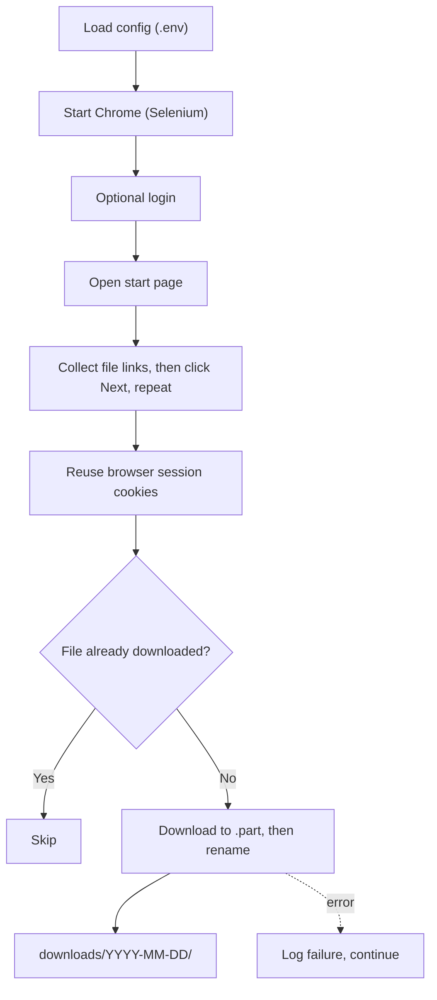

# 📥 Portal File Downloader

A configurable **Selenium + Requests** tool that walks through paginated web pages, finds downloadable files, and saves them locally, built to be **safe to re-run, fault-tolerant, and read-only**.

> **Topics:** `selenium` `web-automation` `data-ingestion` `python` `idempotency` `fault-tolerance`

Works with **any site you are authorised to access**. Nothing in this repo is specific to a particular company or system.

---

## Workflow



## Engineering properties

| Property | Implementation |
|---|---|
| **Idempotent** | Existing non-empty files are skipped, so re-running never creates duplicates |
| **Atomic writes** | Streams to `*.part` then renames, so interrupted runs never leave corrupt files that look complete |
| **Fault-tolerant** | Per-file `try/except`: one failure is logged and the run continues |
| **Throttled** | Configurable delay between downloads and page changes |
| **Read-only** | Only reads pages and downloads files; never modifies the site |
| **Paginated** | Follows a configurable "next page" control up to `MAX_PAGES` |
| **Secrets out of code** | Settings and credentials via `.env` (git-ignored) |

## Usage
```bash
pip install -r requirements.txt
cp .env.example .env          # set START_URL, FILE_EXTENSIONS, NEXT_SELECTOR, ...
python downloader.py
pytest                         # tests for idempotency, atomic writes, error handling
```
Requires Google Chrome (Selenium 4 manages the driver automatically).

## Responsible use
Only run this against sites you own or have explicit permission to automate, respect their terms of service and robots rules, and keep the throttle on.

## My role
> **[Edit to match]** Designed and implemented the tool and its tests.

## Tech stack
Python · Selenium · Requests · python-dotenv · pytest
